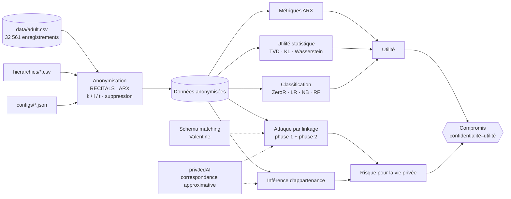

# TER - Anonymiser les données, puis essayer de les casser

<p align="center">
  <a href="README.md">🇬🇧 English</a> · <b>🇫🇷 Français</b>
</p>

<p align="center">
  <a href="https://github.com/Yvngval/TER_Project/actions/workflows/deploy.yml"></a>
  <a href="https://www.python.org"></a>
  <a href="https://arx.deidentifier.org"></a>
  <a href="https://scikit-learn.org"></a>
  <a href="https://archive.ics.uci.edu/dataset/2/adult"></a>
  <a href="LICENSE"></a>
  <a href="https://yvngval.github.io/TER_Project/"></a>
</p>

TER_Project est un benchmark de recherche, réalisé dans le cadre d'un **TER (Travail d'Étude et de Recherche)**, qui mesure de bout en bout le **compromis confidentialité–utilité de l'anonymisation des données**. Il anonymise le dataset de recensement UCI Adult avec ARX (via le framework RECITALS), mesure la part d'information utile qui survit, puis attaque les données publiées avec des **attaques par linkage** et des **attaques par inférence d'appartenance** pour mesurer la part de confidentialité qui survit réellement.

**Deux questions, un seul pipeline.** *Combien coûte l'anonymisation ?* On y répond avec les métriques de qualité d'ARX, des distances statistiques et des classifieurs entraînés sur les données anonymisées. *Combien protège-t-elle ?* On y répond avec des attaquants réalistes, qui disposent de connaissances externes, peuvent retrouver des noms de colonnes masqués par schema matching et font des correspondances approximatives par record linkage préservant la confidentialité. Chaque expérience est pilotée par une config JSON, reproductible à partir d'une graine aléatoire, et produit des métriques exploitables par machine ainsi qu'un rapport HTML autonome.

[Documentation](https://yvngval.github.io/TER_Project/) · [Démarrage rapide](#démarrage-rapide) · [Vue d'ensemble](#vue-densemble) · [Attaques](#attaques-contre-la-confidentialité) · [Résultats clés](#résultats-clés) · [Scripts](#référence-des-scripts) · [Sorties](#sorties)

<div align="center">
  
</div>

---

## Points forts

- **Anonymisation configurable** : k-anonymat, l-diversité, t-proximité et limites de suppression, avec des hiérarchies de généralisation pour 9 quasi-identifiants, et 9 modèles de qualité ARX × 5 fonctions d'agrégation pour guider l'optimisation.
- **Benchmarks en grille** : on balaie sous-ensembles de QI × k × l × modèles de qualité × fonctions d'agrégation en une seule commande, et chaque exécution est enregistrée dans un unique CSV récapitulatif.
- **Trois angles sur l'utilité** : métriques ARX (granularité, entropie, discernabilité, …), distances statistiques (TVD, KL, Wasserstein, dérive des corrélations) et **classifieurs fidèles à ARX** (ZeroR, régression logistique, Naive Bayes, Random Forest) en validation croisée stratifiée à 10 plis.
- **Attaque par linkage en deux phases** : la phase 1 restreint les candidats via les QI généralisés, la phase 2 affine sur les attributs en clair, avec en option la correspondance approximative de **privJedAI** par filtres de Bloom.
- **Attaque par inférence d'appartenance (MIA)** : détermine si une cible faisait partie du dataset publié, évaluée sur des cibles IN/OUT équilibrées.
- **Schema matching** : modélise un attaquant qui ne connaît *pas* les noms des colonnes, et utilise [Valentine](https://github.com/delftdata/valentine) (COMA, Jaccard, approche par distribution) pour retrouver à quoi correspondent les colonnes masquées.
- **Campagnes d'attaques** : trois études structurées (profil d'attaquant, déclaration des QI, valeur de k) plus une référence sans anonymisation, lancées en une seule commande.
- **Des rapports partout** : rapports HTML pour l'anonymisation, le linkage et la MIA, et pages PNG façon ARX avec courbes ROC pour la classification.

---

## Démarrage rapide

### 1. Prérequis

| Composant | Version / remarques |
|---|---|
| Python | **3.12** (fixé dans `.python-version`) |
| Java (JDK) | Nécessaire au moteur ARX utilisé via RECITALS |
| RECITALS | [RECITALS anonymization manager](https://github.com/neithanmo/RECITALS-anonymization-manager), cloné à la racine du projet **ou** à côté (`run_ano.py` cherche aux deux endroits) |
| Packages Python | `pandas`, `numpy`, `scikit-learn`, `matplotlib`, `valentine` (schema matching) |
| privJedAI | Inclus dans `privJedAI-main/` (optionnel, seulement pour la correspondance approximative) |

### 2. Installation

```bash
git clone https://github.com/Yvngval/TER_Project.git
cd TER_Project
python -m venv .venv
source .venv/bin/activate          # Windows : .venv\Scripts\activate
pip install pandas numpy scikit-learn matplotlib valentine
```

Clone RECITALS à côté du projet, puis applique le correctif ponctuel sur la limite de suppression, qui convertit `10` (pourcentage) en ratio `0.1` comme l'attend ARX :

```bash
git clone https://github.com/neithanmo/RECITALS-anonymization-manager.git ../RECITALS-anonymization-manager
python scripts/patch_recitals_arx.py
```

Optionnel, pour la correspondance approximative privJedAI dans les attaques :

```bash
pip install -e privJedAI-main
```

### 3. Lancer une première expérience

Anonymise Adult une fois avec la configuration de base (QI `age, sex, race, marital-status, native-country`, k=5, l=2) :

```bash
python scripts/run_ano.py --config configs/base_config.json --save-anonymized-csv
```

Tu obtiens `outputs/anonymized/<id>.csv`, `outputs/metrics/<id>.json` et une nouvelle ligne dans `outputs/benchmark_summary.csv`. Mesure ensuite ce que ça a coûté :

```bash
python scripts/run_utility_benchmark.py
python scripts/run_classification_benchmark.py
python scripts/generate_anonymization_report.py
```

Ouvre le rapport HTML généré pour consulter les résultats.

---

## Vue d'ensemble



- **L'anonymisation** ([`run_ano.py`](scripts/run_ano.py), [`run_benchmark.py`](scripts/run_benchmark.py)) transforme une config et un ensemble de hiérarchies de généralisation en un dataset publié et un JSON de métriques.
- **L'utilité** est mesurée de trois façons : les métriques propres à ARX, des distances entre distributions ([`compute_utility_metrics.py`](scripts/compute_utility_metrics.py)), et la capacité des classifieurs à prédire encore `income` ([`run_classification_benchmark.py`](scripts/run_classification_benchmark.py)).
- **La confidentialité** est mesurée en attaquant les données publiées : un attaquant par linkage qui tente de réidentifier des personnes connues ([`run_linkage_attack.py`](scripts/run_linkage_attack.py)), et un attaquant qui tente de déterminer qui faisait partie des données ([`run_mia_attack.py`](scripts/run_mia_attack.py)).
- **Les campagnes** ([`run_attack_benchmark.py`](scripts/run_attack_benchmark.py), [`run_linkage_phase_curve.py`](scripts/run_linkage_phase_curve.py)) enchaînent tout cela sur de nombreuses publications et profils d'attaquants.

---

## Dataset

Le dataset [UCI Adult](https://archive.ics.uci.edu/dataset/2/adult) : **32 561 enregistrements** issus du recensement américain de 1994, 15 attributs, avec la cible binaire `income` (`<=50K` / `>50K`).

| Rôle | Attributs |
|---|---|
| Quasi-identifiants (QI) | Choisis pour chaque expérience parmi `age`, `sex`, `race`, `marital-status`, `native-country`, `education`, `occupation`, `workclass`, `relationship` |
| Attribut sensible | `income` |
| Attributs non sensibles | Tout le reste (`fnlwgt`, `capital-gain`, `capital-loss`, `hours-per-week`, …) |
| Identifiant interne | `record_id` (dans `data/adult_with_record_id.csv`), utilisé uniquement pour vérifier les attaques par rapport à la vérité terrain, jamais publié |

Chaque QI possède une hiérarchie de généralisation dans `hierarchies/`, qui va de la valeur brute jusqu'à `*`. Par exemple, `age` se généralise ainsi : `25 → 25-29 → 20-29 → *`.

---

## Anonymisation

L'anonymisation est confiée à **ARX** via le framework Python **RECITALS**.

| Modèle de confidentialité | Paramètre | Signification |
|---|---|---|
| k-anonymat | `k` | Chaque enregistrement est indiscernable d'au moins `k-1` autres sur les QI |
| l-diversité | `l` | Chaque classe d'équivalence contient au moins `l` valeurs distinctes de l'attribut sensible |
| t-proximité | `t` | La distribution de l'attribut sensible dans chaque classe reste à moins de `t` de la distribution globale |
| Suppression | `suppression_limit` | Part maximale d'enregistrements qu'ARX peut supprimer au lieu de généraliser davantage |

ARX parcourt le treillis de généralisation pour trouver la transformation qui respecte le modèle de confidentialité avec la plus faible perte d'information. Cette perte est définie par un **modèle de qualité** (`loss`, `height`, `precision`, `nm_entropy`, `entropy`, `discernibility`, `aecs`, `ambiguity`, `classification`) combiné entre les attributs par une **fonction d'agrégation** (`arithmetic_mean`, `geometric_mean`, `sum`, `maximum`, `rank`).

Voici à quoi ressemble une config d'expérience minimale :

```json
{
  "data": "data/adult.csv",
  "hierarchy_dir": "hierarchies",
  "quasi_identifiers": ["age", "sex", "race", "marital-status", "native-country"],
  "sensitive_attributes": ["income"],
  "k": 5,
  "l": 2,
  "t": null,
  "suppression_limit": 0.1,
  "utility_measure": "loss",
  "utility_aggregate": "arithmetic_mean",
  "backend": "arx"
}
```

Pour balayer une grille complète, décris-la dans [`configs/benchmark_grid.json`](configs/benchmark_grid.json) (tailles des sous-ensembles de QI, valeurs de k et de l, modèles de qualité, fonctions d'agrégation), puis lance :

```bash
python scripts/run_benchmark.py --grid configs/benchmark_grid.json
```

---

## Évaluation de l'utilité

### Métriques ARX

Elles sont collectées automatiquement après chaque anonymisation :

- statistiques des classes d'équivalence : nombre, taille min / moyenne / max, enregistrements supprimés
- métriques par attribut : granularité, entropie non uniforme, intensité de généralisation, erreur quadratique
- métriques globales : discernabilité, ambiguïté, SSESST, erreur quadratique au niveau des enregistrements

### Utilité statistique

[`run_utility_benchmark.py`](scripts/run_utility_benchmark.py) compare colonne par colonne les distributions originales et anonymisées. Il calcule la distance en variation totale, la divergence de KL, la distance de Wasserstein, la dérive de la moyenne et de l'écart-type, ainsi que la norme de Frobenius de la variation de la matrice de corrélation. Les intervalles généralisés comme `20-29` sont remplacés par leur milieu, pour que les métriques numériques gardent un sens.

### Utilité en classification

[`run_classification_benchmark.py`](scripts/run_classification_benchmark.py) reproduit dans scikit-learn l'évaluation par classification d'ARX :

1. Découper les données originales en **10 plis stratifiés**.
2. Pour chaque pli, entraîner et prédire sur les données originales, puis entraîner et prédire sur les données anonymisées (alignées ligne à ligne).
3. Concaténer globalement les prédictions hors pli et calculer les métriques une seule fois, comme le fait ARX.

| Classifieur | Implémentation |
|---|---|
| ZeroR | `DummyClassifier(strategy="prior")`, la référence |
| Régression logistique | `LogisticRegression` avec un prétraitement proche d'ARX |
| Naive Bayes | Multinomial, avec discrétisation des attributs numériques |
| Random Forest | `RandomForestClassifier` |

Les métriques produites sont l'exactitude, l'**exactitude relative** (la position du modèle anonymisé entre ZeroR et le modèle original), l'AUC avec les courbes ROC, le score de Brier, le Brier skill score, la sensibilité et la spécificité. Tous les hyperparamètres se trouvent dans [`configs/classification_config.json`](configs/classification_config.json).

---

## Attaques contre la confidentialité

Toutes les attaques visent le CSV anonymisé **public**. `record_id` est retiré des données publiées et sert uniquement à vérifier les réponses de l'attaquant par rapport à la vérité terrain.

### Attaque par linkage (réidentification)

L'attaquant dispose d'une **base de connaissances auxiliaire** : un échantillon de personnes réelles avec certains de leurs attributs ([`make_auxiliary_base.py`](scripts/make_auxiliary_base.py)). Pour chaque cible :

1. **Phase 1, QI généralisés.** Projeter les valeurs connues de la cible sur la généralisation appliquée par ARX (par exemple `age 27 → 20-29`) et garder la classe d'équivalence correspondante.
2. **Phase 2, affinage sur les attributs en clair.** Filtrer cette classe sur les attributs que les données publiées montrent encore en clair (`visible_level == 0`), par correspondance exacte ou, en option, par correspondance approximative **privJedAI** (filtres de Bloom sur des q-grammes, avec une métrique et un seuil de similarité configurables).
3. **Score.** La cible est *réidentifiée de manière unique* s'il ne reste qu'un seul candidat et que c'est la bonne personne.

Sorties principales : le taux de réidentification unique, les tailles médianes des classes d'équivalence après la phase 1 et après la phase 2, et la probabilité de deviner la vraie valeur sensible.

```bash
python scripts/run_linkage_attack.py \
  --config outputs/configs/<id>.json \
  --auxiliary outputs/auxiliary/<aux>.csv \
  --anonymized outputs/anonymized/<id>.csv \
  --anonymized-eval outputs/anonymized_eval/<id>.csv
```

### Schema matching

Un attaquant réaliste peut ne pas connaître les noms des colonnes des données publiées. [`schema_matcher.py`](scripts/schema_matcher.py) renomme les colonnes en clair en `col_0`, `col_1`, …, puis utilise les matchers de **Valentine** basés sur les valeurs (COMA, distance de Jaccard, approche par distribution) pour retrouver à quels attributs de l'attaquant elles correspondent, avant la phase 2. Pour le voir isolément :

```bash
python scripts/demo_schema_matching.py
```

### Attaque par inférence d'appartenance (MIA)

Le dataset est découpé une seule fois en `published.csv` (membres) et `out.csv` (non-membres) ([`make_mia_targets.py`](scripts/make_mia_targets.py)). Après l'anonymisation, un ensemble équilibré de cibles IN et OUT est tiré ([`make_mia_targets_post_ano.py`](scripts/make_mia_targets_post_ano.py)). L'attaquant applique la même réduction phase 1 / phase 2 et prédit *membre* s'il reste au moins un candidat compatible, éventuellement sous une fraction compatible maximale. L'attaque est évaluée par l'exactitude, la précision, le rappel et le F1.

---

## Campagnes d'attaques

[`run_attack_benchmark.py`](scripts/run_attack_benchmark.py) lance une campagne complète d'attaques par linkage et MIA, avec mise en cache.

**Profils d'attaquants**

| Profil | Attributs connus |
|---|---|
| `A1_demographic` | age, sex, race |
| `A2_demographic_geo` | age, sex, race, native-country |
| `A3_professional` | age, sex, education, occupation, workclass, hours-per-week |
| `A4_social` | age, sex, race, marital-status, relationship |
| `A5_strong` | tout ce qui est visible dans les données publiées (pire cas) |

**Études**

| Étude | Ce qui varie | Ce qui est fixé |
|---|---|---|
| Référence | Profil d'attaquant A1–A5 | Aucune anonymisation (borne haute du succès des attaques) |
| Étude 1 | Profil d'attaquant A1–A5 | Publication R3 = {age, sex, race, native-country}, k=5, l=2, 10 % de suppression |
| Étude 2 | Déclaration des QI, de R1 (minimale) à R6 (maximale) | A5, k=5, l=2 |
| Étude 3 | k ∈ {2, 5, 10, 20, 50} | R3, A5 |

```bash
python scripts/run_attack_benchmark.py \
  --base-config configs/adult_demo_with_record_id.json \
  --full-dataset data/adult_with_record_id.csv \
  --output-root outputs \
  --campaign-name attack_benchmark_v2 \
  --seed 42
```

Les publications déjà anonymisées sont réutilisées lors des exécutions suivantes ; ajoute `--force-rebuild` pour les refaire depuis zéro. Les autres options sont `--only-studies`, `--linkage-n-targets`, `--mia-targets-per-class`, `--attacker-frac` et `--linkage-aux-frac`.

[`run_linkage_phase_curve.py`](scripts/run_linkage_phase_curve.py) tire plutôt N publications aléatoires (sous-ensembles aléatoires de QI et d'attributs non sensibles) et trace à quel point la phase 2 réduit l'ensemble des candidats. C'est la figure en haut de cette page.

---

## Résultats clés

Ces chiffres proviennent de la campagne archivée dans `outputs/campaigns/attack_benchmark_v2.zip` (500 cibles par attaque, graine 42) et des récapitulatifs dans `outputs/`.

**Linkage : taux de réidentification unique**

| Publication | A1 démographique | A2 démo + géo | A3 professionnel | A4 social | A5 fort |
|---|---|---|---|---|---|
| Sans anonymisation | 0,2 % | 4,6 % | 57,4 % | 5,0 % | 99,6 % |
| R3, k=5, l=2 | 0,0 % | 0,0 % | 24,0 % | 0,2 % | **99,6 %** |

**Inférence d'appartenance : exactitude (équilibré, 50 % = hasard)**

| Publication | A1 | A2 | A3 | A4 | A5 |
|---|---|---|---|---|---|
| Sans anonymisation | 50,2 % | 53,1 % | 78,4 % | 52,7 % | 100 % |
| R3, k=5, l=2 | 48,3 % | 48,5 % | 63,8 % | 50,9 % | **99,9 %** |

**Utilité de la publication à 8 QI (k=5, l=2)**

| Classifieur | Exactitude sur données originales | Exactitude sur données anonymisées | ROC AUC sur données originales | ROC AUC sur données anonymisées |
|---|---|---|---|---|
| Régression logistique | 85,2 % | 83,5 % | 0,907 | 0,891 |
| Naive Bayes | 82,0 % | 81,1 % | 0,896 | 0,879 |

Ce que ça montre :

- **Le k-anonymat protège contre les attaquants faibles.** Face aux profils démographiques (A1, A2, A4), la réidentification tombe à environ 0 % et la MIA revient au niveau du hasard.
- **Il ne protège pas contre un attaquant qui connaît les attributs en clair.** La phase 1 laisse encore des milliers de candidats, mais l'affinage sur les colonnes non généralisées réduit la classe à **une seule personne** dans plus de 99 % des cas. C'est vrai quelle que soit la déclaration des QI (étude 2) et quelle que soit la valeur de k, de 2 à 50 (étude 3).
- **Le choix des quasi-identifiants compte plus que le réglage de k.** Les attributs non sensibles laissés en clair sont la vraie fuite.
- **L'utilité reste élevée.** Les classifieurs ne perdent que 1 à 2 points d'exactitude, et la distribution de `income` bouge à peine (TVD moyenne sur l'attribut sensible ≈ 0,006–0,019).

---

## Référence des scripts

| Domaine | Script | Rôle |
|---|---|---|
| Anonymisation | `run_ano.py` | Lancer une expérience d'anonymisation à partir d'une config |
| | `run_benchmark.py` | Lancer une grille de paramètres complète |
| | `patch_recitals_arx.py` | Correctif ponctuel du format de la limite de suppression dans RECITALS |
| | `prepare_dataset_with_record_id.py` | Ajouter un `record_id` unique au dataset |
| Utilité | `compute_utility_metrics.py` / `run_utility_benchmark.py` | Distances statistiques entre données originales et anonymisées |
| | `classification_models.py` | Pipelines scikit-learn fidèles à ARX |
| | `compute_classification_metrics.py` / `run_classification_benchmark.py` | Utilité en classification par validation croisée à 10 plis |
| | `plot_classification_results.py` | Pages PNG façon ARX avec courbes ROC |
| Attaques | `make_auxiliary_base.py` | Construire la base de connaissances de l'attaquant par linkage |
| | `run_linkage_attack.py` | Attaque par linkage en deux phases |
| | `make_mia_targets.py` / `make_mia_targets_post_ano.py` | Découpage pour la MIA et cibles équilibrées |
| | `run_mia_attack.py` | Attaque par inférence d'appartenance |
| | `schema_matcher.py` / `demo_schema_matching.py` | Retrouver les colonnes avec Valentine |
| | `privjedai_utils.py` | Intégration de la correspondance approximative privJedAI |
| | `attack_common.py` / `linkage_helpers.py` | Logique commune aux attaques |
| Campagnes | `run_attack_benchmark.py` | Études 1 à 3 plus la référence |
| | `run_linkage_phase_curve.py` | Courbe phase 1 / phase 2 sur des publications aléatoires |
| Rapports | `generate_anonymization_report.py` | Rapport HTML des anonymisations |
| | `generate_linkage_attack_report.py` / `generate_mia_attack_report.py` | Rapports HTML de chaque attaque |
| | `classification_report_section.py` | Section classification intégrée aux rapports |
| Maintenance | `common.py` | E/S JSON, identifiants d'expérience, sous-ensembles de QI, correspondance des hiérarchies |
| | `clean_outputs.py` | Effacer les sorties générées pour repartir de zéro |

---

## Sorties

```text
outputs/
├── anonymized/            # données anonymisées publiques (CSV)
├── anonymized_eval/       # versions internes qui gardent record_id (jamais publiées)
├── metrics/               # métriques ARX par expérience (JSON)
├── configs/               # configs d'exécution résolues (trace de reproductibilité)
├── utility/               # utilité statistique par expérience (JSON)
├── classification/        # résultats de classification par expérience (JSON + PNG)
├── auxiliary/             # bases de connaissances des attaquants
├── mia_targets/           # cibles IN/OUT pour la MIA
├── linkage_phase_curve/   # balayage de publications aléatoires : plan, exécutions, agrégats, graphiques
├── campaigns/             # campagnes d'attaques complètes (CSV + rapports HTML)
├── benchmark_summary.csv  # une ligne par expérience d'anonymisation
├── utility_summary.csv    # une ligne par évaluation d'utilité
└── classification_summary.csv
```

Les identifiants d'expérience encodent leurs propres paramètres, donc le nom d'un fichier suffit à savoir ce qu'il contient, par exemple `qi_age-sex-race-native-country__k_5__l_2__t_None__supp_0.1__arx`.

---

## Organisation du dépôt

```text
TER_Project/
├── configs/          # configs d'expériences, de grilles, de classification et d'attaques
├── data/             # adult.csv et adult_with_record_id.csv
├── docs/             # documentation MkDocs (déployée sur GitHub Pages)
├── hierarchies/      # hiérarchies de généralisation, un CSV par QI
├── outputs/          # résultats générés (voir ci-dessus)
├── privJedAI-main/   # bibliothèque privJedAI incluse, pour le record linkage préservant la confidentialité
├── scripts/          # tout le pipeline
└── mkdocs.yml
```

---

## Documentation

La documentation complète est construite avec MkDocs Material et déployée automatiquement sur GitHub Pages à chaque push sur `main`. Elle est rédigée en anglais.

| Sujet | Par où commencer |
|---|---|
| Vue d'ensemble et pipeline | [Overview](https://yvngval.github.io/TER_Project/) |
| Modèles de confidentialité et hiérarchies | [Anonymization](https://yvngval.github.io/TER_Project/anonymisation/) |
| Guider l'optimisation d'ARX | [Quality models](https://yvngval.github.io/TER_Project/anonymisation/mesures_utilite/) · [Aggregate functions](https://yvngval.github.io/TER_Project/anonymisation/fonctions_agregats/) |
| Ce qu'ARX mesure après l'anonymisation | [ARX utility metrics](https://yvngval.github.io/TER_Project/metriques/) |
| Utilité mesurée par des classifieurs | [Classification](https://yvngval.github.io/TER_Project/classification/) |
| Rôle de chaque script et de chaque fichier | [Script structure](https://yvngval.github.io/TER_Project/structure_scripts/) · [File formats](https://yvngval.github.io/TER_Project/formats_fichiers/) |

Pour prévisualiser la documentation en local :

```bash
pip install mkdocs-material
mkdocs serve
```

---

## Éthique

Ce projet attaque des données anonymisées **uniquement pour mesurer le risque**. Il utilise un dataset de recherche public et très étudié, et chaque attaque est évaluée à l'aide d'un `record_id` interne qui ne fait jamais partie des données publiées. N'exécute pas ces attaques sur de vraies données personnelles sans base légale ni autorisation explicite.

---

## Outils utilisés

- [ARX](https://arx.deidentifier.org) : moteur d'anonymisation en Java
- [RECITALS](https://github.com/neithanmo/RECITALS-anonymization-manager) : gestionnaire d'anonymisation en Python, avec ARX comme moteur
- [privJedAI](https://github.com/AI-team-UoA/privJedAI) : record linkage préservant la confidentialité
- [Valentine](https://github.com/delftdata/valentine) : schema matching
- [scikit-learn](https://scikit-learn.org), [pandas](https://pandas.pydata.org), [NumPy](https://numpy.org), [Matplotlib](https://matplotlib.org)
- [MkDocs Material](https://squidfunk.github.io/mkdocs-material/) : documentation

---

## Licence

Le code du projet est publié sous [licence MIT](LICENSE) © 2026 Louis Jauniau et Yvngval.

Les composants tiers gardent leur propre licence : la bibliothèque incluse [`privJedAI-main/`](privJedAI-main/LICENSE) est sous Apache 2.0, et le dataset [UCI Adult](https://archive.ics.uci.edu/dataset/2/adult) est sous CC BY 4.0.

---

## Contributeurs

<a href="https://github.com/LouisJauniau"></a>
<a href="https://github.com/Yvngval"></a>

Projet de recherche TER réalisé par [@LouisJauniau](https://github.com/LouisJauniau) et [@Yvngval](https://github.com/Yvngval).
