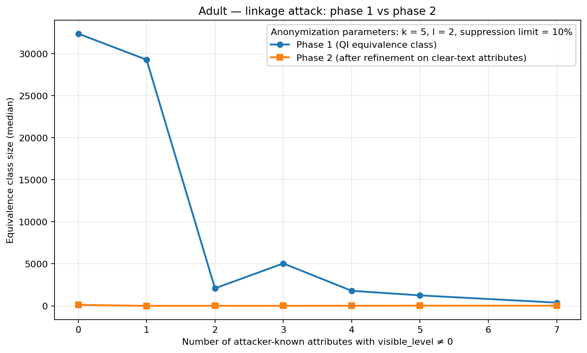
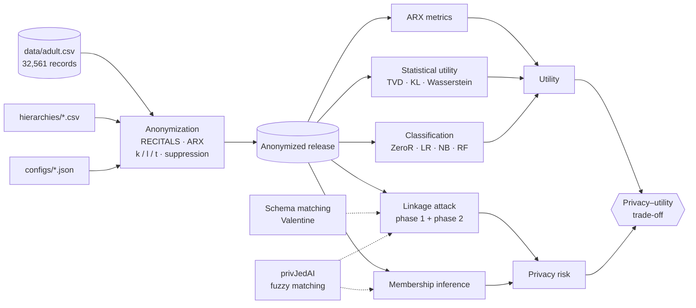

# TER - Anonymize the data, then try to break it

<p align="center">
  <b>🇬🇧 English</b> · <a href="README.fr.md">🇫🇷 Français</a>
</p>

<p align="center">
  <a href="https://github.com/Yvngval/TER_Project/actions/workflows/deploy.yml"></a>
  <a href="https://www.python.org"></a>
  <a href="https://arx.deidentifier.org"></a>
  <a href="https://scikit-learn.org"></a>
  <a href="https://archive.ics.uci.edu/dataset/2/adult"></a>
  <a href="https://yvngval.github.io/TER_Project/"></a>
</p>

TER_Project is a research benchmark, built for a **TER (Travail d'Étude et de Recherche)**, that measures the **privacy–utility trade-off of data anonymization** end to end. It anonymizes the UCI Adult census dataset with ARX (through the RECITALS framework), measures how much useful information survives, and then attacks the released data with **linkage** and **membership inference** attacks to measure how much privacy actually survives.

**Two questions, one pipeline.** *How much does anonymization cost?* We answer with ARX quality metrics, statistical distances, and classifiers trained on the anonymized data. *How much does it protect?* We answer with realistic attackers who hold background knowledge, can recover obfuscated column names via schema matching, and match fuzzily via privacy-preserving record linkage. Every experiment is driven by a JSON config, is reproducible from a seed, and produces machine-readable metrics plus a self-contained HTML report.

[Documentation](https://yvngval.github.io/TER_Project/) · [Quick start](#quick-start) · [How it fits together](#how-it-fits-together) · [Attacks](#privacy-attacks) · [Key findings](#key-findings) · [Scripts](#script-reference) · [Outputs](#outputs)

<div align="center">
  
</div>

---

## Highlights

- **Configurable anonymization** — k-anonymity, l-diversity, t-closeness and suppression limits, with generalization hierarchies for 9 quasi-identifiers and 9 ARX quality models × 5 aggregate functions to guide the optimization.
- **Grid benchmarks** — sweep QI subsets × k × l × quality models × aggregate functions in one command; every run is logged to a single summary CSV.
- **Three lenses on utility** — ARX metrics (granularity, entropy, discernibility, …), statistical distances (TVD, KL, Wasserstein, correlation drift), and **ARX-faithful classifiers** (ZeroR, Logistic Regression, Naive Bayes, Random Forest) with 10-fold stratified CV.
- **Two-phase linkage attack** — phase 1 narrows candidates through the generalized QIs, phase 2 refines on clear-text attributes, with optional **privJedAI** Bloom-filter fuzzy matching.
- **Membership inference attack (MIA)** — decides whether a target was in the published dataset, evaluated on balanced IN/OUT targets.
- **Schema matching** — models an attacker who does *not* know the column names, using [Valentine](https://github.com/delftdata/valentine) (COMA, Jaccard, distribution-based) to map obfuscated columns back.
- **Attack campaigns** — three structured studies (attacker profile, QI declaration, value of k) plus an unanonymized baseline, run with one command.
- **Reports everywhere** — HTML reports for anonymization, linkage and MIA runs; ARX-style PNG pages with ROC curves for classification.

---

## Quick start

### 1. Requirements

| Component | Version / notes |
|---|---|
| Python | **3.12** (pinned in `.python-version`) |
| Java (JDK) | Required by the ARX engine used through RECITALS |
| RECITALS | [RECITALS anonymization manager](https://github.com/neithanmo/RECITALS-anonymization-manager), cloned into the project root **or** next to it (`run_ano.py` looks in both places) |
| Python packages | `pandas`, `numpy`, `scikit-learn`, `matplotlib`, `valentine` (schema matching) |
| privJedAI | Vendored in `privJedAI-main/` (optional, only for fuzzy matching) |

### 2. Install

```bash
git clone https://github.com/Yvngval/TER_Project.git
cd TER_Project
python -m venv .venv
source .venv/bin/activate          # Windows: .venv\Scripts\activate
pip install pandas numpy scikit-learn matplotlib valentine
```

Clone RECITALS next to the project and apply the one-time suppression-limit patch, which converts `10` (percent) into the `0.1` ratio ARX expects:

```bash
git clone https://github.com/neithanmo/RECITALS-anonymization-manager.git ../RECITALS-anonymization-manager
python scripts/patch_recitals_arx.py
```

Optional, for privJedAI fuzzy matching in the attacks:

```bash
pip install -e privJedAI-main
```

### 3. Run your first experiment

Anonymize Adult once with the base configuration (QIs `age, sex, race, marital-status, native-country`, k=5, l=2):

```bash
python scripts/run_ano.py --config configs/base_config.json --save-anonymized-csv
```

You get `outputs/anonymized/<id>.csv`, `outputs/metrics/<id>.json`, and a new row in `outputs/benchmark_summary.csv`. Then measure what it cost:

```bash
python scripts/run_utility_benchmark.py
python scripts/run_classification_benchmark.py
python scripts/generate_anonymization_report.py
```

Open the generated HTML report to inspect the results.

---

## How it fits together



- **Anonymization** ([`run_ano.py`](scripts/run_ano.py), [`run_benchmark.py`](scripts/run_benchmark.py)) turns a config and a set of generalization hierarchies into a released dataset and a metrics JSON.
- **Utility** is measured three ways: ARX's own metrics, distribution-level distances ([`compute_utility_metrics.py`](scripts/compute_utility_metrics.py)), and how well classifiers still predict `income` ([`run_classification_benchmark.py`](scripts/run_classification_benchmark.py)).
- **Privacy** is measured by attacking the release: a linkage attacker who tries to re-identify known people ([`run_linkage_attack.py`](scripts/run_linkage_attack.py)), and a membership attacker who tries to tell who was in the data ([`run_mia_attack.py`](scripts/run_mia_attack.py)).
- **Campaigns** ([`run_attack_benchmark.py`](scripts/run_attack_benchmark.py), [`run_linkage_phase_curve.py`](scripts/run_linkage_phase_curve.py)) chain all of the above over many releases and attacker profiles.

---

## Dataset

The [UCI Adult](https://archive.ics.uci.edu/dataset/2/adult) dataset: **32,561 records** from the 1994 U.S. Census, 15 attributes, with the binary target `income` (`<=50K` / `>50K`).

| Role | Attributes |
|---|---|
| Quasi-identifiers (QI) | Chosen per experiment from `age`, `sex`, `race`, `marital-status`, `native-country`, `education`, `occupation`, `workclass`, `relationship` |
| Sensitive attribute | `income` |
| Insensitive attributes | Everything else (`fnlwgt`, `capital-gain`, `capital-loss`, `hours-per-week`, …) |
| Internal identifier | `record_id` (in `data/adult_with_record_id.csv`), used only to score attacks against ground truth, never published |

Each QI has a generalization hierarchy in `hierarchies/` that goes from the raw value to `*`. For example, `age` generalizes as `25 → 25-29 → 20-29 → *`.

---

## Anonymization

Anonymization is delegated to **ARX** through the **RECITALS** Python framework.

| Privacy model | Parameter | Meaning |
|---|---|---|
| k-anonymity | `k` | Every record is indistinguishable from at least `k-1` others on the QIs |
| l-diversity | `l` | Each equivalence class has at least `l` distinct values of the sensitive attribute |
| t-closeness | `t` | The sensitive distribution in each class stays within `t` of the global one |
| Suppression | `suppression_limit` | Maximum share of records ARX may suppress instead of generalizing further |

ARX searches the generalization lattice for the transformation that satisfies the privacy model at the lowest information loss. That loss is defined by a **quality model** (`loss`, `height`, `precision`, `nm_entropy`, `entropy`, `discernibility`, `aecs`, `ambiguity`, `classification`) combined across attributes by an **aggregate function** (`arithmetic_mean`, `geometric_mean`, `sum`, `maximum`, `rank`).

A minimal experiment config looks like this:

```json
{
  "data": "data/adult.csv",
  "hierarchy_dir": "hierarchies",
  "quasi_identifiers": ["age", "sex", "race", "marital-status", "native-country"],
  "sensitive_attributes": ["income"],
  "k": 5,
  "l": 2,
  "t": null,
  "suppression_limit": 0.1,
  "utility_measure": "loss",
  "utility_aggregate": "arithmetic_mean",
  "backend": "arx"
}
```

To sweep a whole grid, describe it in [`configs/benchmark_grid.json`](configs/benchmark_grid.json) (QI subset sizes, k values, l values, quality models, aggregate functions) and run:

```bash
python scripts/run_benchmark.py --grid configs/benchmark_grid.json
```

---

## Utility evaluation

### ARX metrics

These are collected automatically after each anonymization:

- equivalence class statistics: count, min / average / max size, suppressed records
- per-attribute metrics: granularity, non-uniform entropy, generalization intensity, squared error
- global metrics: discernibility, ambiguity, SSESST, record-level squared error

### Statistical utility

[`run_utility_benchmark.py`](scripts/run_utility_benchmark.py) compares the original and anonymized distributions column by column. It reports total variation distance, KL divergence, Wasserstein distance, mean/std drift, and the Frobenius norm of the change in the correlation matrix. Generalized ranges such as `20-29` are mapped to their midpoint, so numeric metrics remain meaningful.

### Classification utility

[`run_classification_benchmark.py`](scripts/run_classification_benchmark.py) reproduces ARX's classification evaluation in scikit-learn:

1. Split the original data into **10 stratified folds**.
2. For each fold, train and predict on the original data, then train and predict on the anonymized data (row-aligned).
3. Concatenate the out-of-fold predictions globally and compute the metrics once, as ARX does.

| Classifier | Implementation |
|---|---|
| ZeroR | `DummyClassifier(strategy="prior")`, the baseline |
| Logistic Regression | `LogisticRegression` with ARX-like preprocessing |
| Naive Bayes | Multinomial, with binning of numeric attributes |
| Random Forest | `RandomForestClassifier` |

Reported metrics are accuracy, **relative accuracy** (where the anonymized model sits between ZeroR and the original model), AUC with ROC curves, Brier score, Brier skill score, sensitivity and specificity. All hyperparameters live in [`configs/classification_config.json`](configs/classification_config.json).

---

## Privacy attacks

All attacks run against the **public** anonymized CSV. `record_id` is stripped from the release and used only to check the attacker's answers against ground truth.

### Linkage attack (re-identification)

The attacker holds an **auxiliary knowledge base**: a sample of real individuals with some of their attributes ([`make_auxiliary_base.py`](scripts/make_auxiliary_base.py)). For each target:

1. **Phase 1, generalized QIs.** Project the target's known values onto the generalization ARX applied (for example, `age 27 → 20-29`) and keep the matching equivalence class.
2. **Phase 2, clear-text refinement.** Filter that class on the attributes the release still shows in clear text (`visible_level == 0`), using exact matching or, optionally, **privJedAI** fuzzy matching (Bloom filters over q-grams, with a configurable similarity metric and threshold).
3. **Score.** The target is *uniquely re-identified* if exactly one candidate remains and it is the right person.

Main outputs: the unique re-identification rate, the median phase-1 and phase-2 equivalence class sizes, and the probability of guessing the true sensitive value.

```bash
python scripts/run_linkage_attack.py \
  --config outputs/configs/<id>.json \
  --auxiliary outputs/auxiliary/<aux>.csv \
  --anonymized outputs/anonymized/<id>.csv \
  --anonymized-eval outputs/anonymized_eval/<id>.csv
```

### Schema matching

A realistic attacker may not know the column names of the release. [`schema_matcher.py`](scripts/schema_matcher.py) renames the clear-text columns `col_0`, `col_1`, …, then uses **Valentine** instance-based matchers (COMA, Jaccard distance, distribution-based) to map them back to the attacker's vocabulary before phase 2. To see it on its own:

```bash
python scripts/demo_schema_matching.py
```

### Membership inference attack (MIA)

The dataset is split once into `published.csv` (members) and `out.csv` (non-members) ([`make_mia_targets.py`](scripts/make_mia_targets.py)). After anonymization, a balanced set of IN and OUT targets is drawn ([`make_mia_targets_post_ano.py`](scripts/make_mia_targets_post_ano.py)). The attacker runs the same phase-1 / phase-2 reduction and predicts *member* if at least one compatible candidate remains, optionally under a maximum compatible fraction. The attack is scored with accuracy, precision, recall and F1.

---

## Attack campaigns

[`run_attack_benchmark.py`](scripts/run_attack_benchmark.py) runs a full, cached campaign of linkage and MIA attacks.

**Attacker profiles**

| Profile | Known attributes |
|---|---|
| `A1_demographic` | age, sex, race |
| `A2_demographic_geo` | age, sex, race, native-country |
| `A3_professional` | age, sex, education, occupation, workclass, hours-per-week |
| `A4_social` | age, sex, race, marital-status, relationship |
| `A5_strong` | everything visible in the release (worst case) |

**Studies**

| Study | What varies | What is fixed |
|---|---|---|
| Baseline | Attacker profile A1–A5 | No anonymization at all (upper bound on attack success) |
| Study 1 | Attacker profile A1–A5 | Release R3 = {age, sex, race, native-country}, k=5, l=2, 10% suppression |
| Study 2 | QI declaration R1 (minimal) → R6 (maximal) | A5, k=5, l=2 |
| Study 3 | k ∈ {2, 5, 10, 20, 50} | R3, A5 |

```bash
python scripts/run_attack_benchmark.py \
  --base-config configs/adult_demo_with_record_id.json \
  --full-dataset data/adult_with_record_id.csv \
  --output-root outputs \
  --campaign-name attack_benchmark_v2 \
  --seed 42
```

Releases that were already anonymized are reused on later runs; add `--force-rebuild` to redo them from scratch. Other options are `--only-studies`, `--linkage-n-targets`, `--mia-targets-per-class`, `--attacker-frac` and `--linkage-aux-frac`.

[`run_linkage_phase_curve.py`](scripts/run_linkage_phase_curve.py) samples N random releases instead (random QI and insensitive subsets) and plots how much phase 2 shrinks the candidate set. That plot is the figure at the top of this page.

---

## Key findings

These numbers come from the campaign archived in `outputs/campaigns/attack_benchmark_v2.zip` (500 targets per attack, seed 42) and from the summaries in `outputs/`.

**Linkage: unique re-identification rate**

| Release | A1 demographic | A2 demo + geo | A3 professional | A4 social | A5 strong |
|---|---|---|---|---|---|
| No anonymization | 0.2% | 4.6% | 57.4% | 5.0% | 99.6% |
| R3, k=5, l=2 | 0.0% | 0.0% | 24.0% | 0.2% | **99.6%** |

**Membership inference: accuracy (balanced, 50% = chance)**

| Release | A1 | A2 | A3 | A4 | A5 |
|---|---|---|---|---|---|
| No anonymization | 50.2% | 53.1% | 78.4% | 52.7% | 100% |
| R3, k=5, l=2 | 48.3% | 48.5% | 63.8% | 50.9% | **99.9%** |

**Utility of the 8-QI release (k=5, l=2)**

| Classifier | Accuracy on original data | Accuracy on anonymized data | ROC AUC on original data | ROC AUC on anonymized data |
|---|---|---|---|---|
| Logistic Regression | 85.2% | 83.5% | 0.907 | 0.891 |
| Naive Bayes | 82.0% | 81.1% | 0.896 | 0.879 |

What this shows:

- **k-anonymity protects against weak attackers.** Against demographic profiles (A1, A2, A4), re-identification drops to about 0% and MIA falls to chance.
- **It does not protect against an attacker who knows the clear-text attributes.** Phase 1 still leaves thousands of candidates, but refining on non-generalized columns collapses the class to **one person** in more than 99% of cases. This holds whatever the QI declaration (Study 2) and whatever the value of k, from 2 to 50 (Study 3).
- **Choosing the quasi-identifiers matters more than tuning k.** Insensitive attributes left in clear text are the real leak.
- **Utility stays high.** Classifiers lose only 1–2 accuracy points, and the distribution of `income` barely moves (mean TVD on the sensitive attribute ≈ 0.006–0.019).

---

## Script reference

| Area | Script | Purpose |
|---|---|---|
| Anonymization | `run_ano.py` | Run one anonymization experiment from a config |
| | `run_benchmark.py` | Run a full parameter grid |
| | `patch_recitals_arx.py` | One-time fix of the RECITALS suppression-limit format |
| | `prepare_dataset_with_record_id.py` | Add a unique `record_id` to the dataset |
| Utility | `compute_utility_metrics.py` / `run_utility_benchmark.py` | Statistical distances between original and anonymized data |
| | `classification_models.py` | ARX-faithful scikit-learn pipelines |
| | `compute_classification_metrics.py` / `run_classification_benchmark.py` | 10-fold CV classification utility |
| | `plot_classification_results.py` | ARX-style PNG pages with ROC curves |
| Attacks | `make_auxiliary_base.py` | Build the linkage attacker's knowledge base |
| | `run_linkage_attack.py` | Two-phase linkage attack |
| | `make_mia_targets.py` / `make_mia_targets_post_ano.py` | MIA split and balanced targets |
| | `run_mia_attack.py` | Membership inference attack |
| | `schema_matcher.py` / `demo_schema_matching.py` | Valentine-based column recovery |
| | `privjedai_utils.py` | privJedAI fuzzy-matching glue |
| | `attack_common.py` / `linkage_helpers.py` | Shared attack logic |
| Campaigns | `run_attack_benchmark.py` | Studies 1–3 plus baseline |
| | `run_linkage_phase_curve.py` | Random-release phase 1 / phase 2 curve |
| Reporting | `generate_anonymization_report.py` | HTML report for anonymization runs |
| | `generate_linkage_attack_report.py` / `generate_mia_attack_report.py` | HTML reports for each attack |
| | `classification_report_section.py` | Classification section embedded in reports |
| Maintenance | `common.py` | JSON I/O, experiment IDs, QI subsets, hierarchy mapping |
| | `clean_outputs.py` | Wipe generated outputs for a clean restart |

---

## Outputs

```text
outputs/
├── anonymized/            # public anonymized releases (CSV)
├── anonymized_eval/       # internal releases that keep record_id (never published)
├── metrics/               # ARX metrics per experiment (JSON)
├── configs/               # resolved runtime configs (reproducibility record)
├── utility/               # statistical utility per experiment (JSON)
├── classification/        # classification results per experiment (JSON + PNG)
├── auxiliary/             # attacker knowledge bases
├── mia_targets/           # IN/OUT targets for MIA
├── linkage_phase_curve/   # random-release sweep: plan, runs, aggregates, plots
├── campaigns/             # full attack campaigns (CSV + HTML reports)
├── benchmark_summary.csv  # one row per anonymization experiment
├── utility_summary.csv    # one row per utility evaluation
└── classification_summary.csv
```

Experiment IDs encode their own parameters, so you can tell what a file contains from its name, for example `qi_age-sex-race-native-country__k_5__l_2__t_None__supp_0.1__arx`.

---

## Repository layout

```text
TER_Project/
├── configs/          # experiment, grid, classification and attack configs
├── data/             # adult.csv and adult_with_record_id.csv
├── docs/             # MkDocs documentation (deployed to GitHub Pages)
├── hierarchies/      # generalization hierarchies, one CSV per QI
├── outputs/          # generated results (see above)
├── privJedAI-main/   # vendored privJedAI library for privacy-preserving record linkage
├── scripts/          # the whole pipeline
└── mkdocs.yml
```

---

## Documentation

The full documentation is built with MkDocs Material and deployed automatically to GitHub Pages on every push to `main`.

| Topic | Start here |
|---|---|
| Overview and pipeline | [Overview](https://yvngval.github.io/TER_Project/) |
| Privacy models and hierarchies | [Anonymization](https://yvngval.github.io/TER_Project/anonymisation/) |
| Guiding the ARX optimization | [Quality models](https://yvngval.github.io/TER_Project/anonymisation/mesures_utilite/) · [Aggregate functions](https://yvngval.github.io/TER_Project/anonymisation/fonctions_agregats/) |
| What ARX measures after anonymization | [ARX utility metrics](https://yvngval.github.io/TER_Project/metriques/) |
| Classifier-based utility | [Classification](https://yvngval.github.io/TER_Project/classification/) |
| What every script and file does | [Script structure](https://yvngval.github.io/TER_Project/structure_scripts/) · [File formats](https://yvngval.github.io/TER_Project/formats_fichiers/) |

To preview the documentation locally:

```bash
pip install mkdocs-material
mkdocs serve
```

---

## Ethics

This project attacks anonymized data **only to measure risk**. It uses a public, widely studied research dataset, and every attack is scored against an internal `record_id` that is never part of a release. Do not run these attacks on real personal data without a legal basis and explicit authorization.

---

## Built with

- [ARX](https://arx.deidentifier.org): Java anonymization engine
- [RECITALS](https://github.com/neithanmo/RECITALS-anonymization-manager): Python anonymization manager with an ARX backend
- [privJedAI](https://github.com/AI-team-UoA/privJedAI): privacy-preserving record linkage
- [Valentine](https://github.com/delftdata/valentine): schema matching
- [scikit-learn](https://scikit-learn.org), [pandas](https://pandas.pydata.org), [NumPy](https://numpy.org), [Matplotlib](https://matplotlib.org)
- [MkDocs Material](https://squidfunk.github.io/mkdocs-material/): documentation

---

## Contributors

<a href="https://github.com/LouisJauniau"></a>
<a href="https://github.com/Yvngval"></a>

Built as a TER research project by [@LouisJauniau](https://github.com/LouisJauniau) and [@Yvngval](https://github.com/Yvngval).
